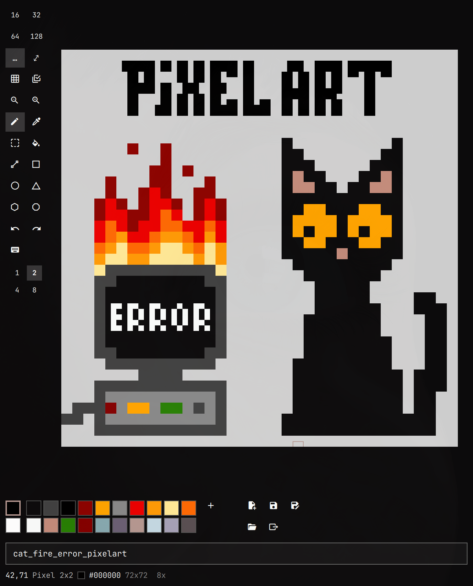

# BurningCat

<p align="center"></p>

A small, keyboard-driven pixel art editor for [Omarchy](https://omarchy.org).
It runs as an Omarchy shell plugin: a keybind opens it as a normal tiled
Hyprland window, and it restyles itself live whenever you change the Omarchy theme.
It is inspired by MS Paint.

## Features

- Canvas from 1x1 up to 512x512, with zoom, grid, and resize that pads or crops
- Pen (1x1 to 8x8), eraser, eyedropper, color fill, and pixel shapes:
  line, rectangle, circle, triangle, hexagon, octagon
- Selection: move, copy, cut, paste, flip, rotate; shift+drag adds more rectangles.
  Copy and paste use the system clipboard, so you can paste images to and from other apps
- Align the separate groups in a selection by their edges or centers, or space them evenly
- Magic wand: click an outline to select it and everything inside it;
  shift+click adds more objects
- Reference: open a second image read-only beside the canvas (`shift+r`),
  switch sides with `w`, and select, copy and pick colors from it
- 22-color palette. A new image starts with the theme's colors, and a loaded
  image brings its own. Color picker with HSV, RGB and HSL modes, plus a
  pipette that picks colors from anywhere on screen
- Undo and redo for every tool
- PNG save and load, and export upscaled 4x, 8x or 16x without blur
- Every action has a key, and you can rebind them in the app

No layers, animation, symmetry, anti-aliasing or filled shapes, by design.

## Install

Requires Omarchy 4, `wl-clipboard` (copy and paste) and `hyprpicker` (screen pipette).

```bash
omarchy plugin add https://github.com/Motzemoere/BurningCat.git --enable
```

Then bind a key to open and close it in `~/.config/hypr/bindings.lua`:

```lua
o.bind("SUPER + ALT + P", "BurningCat", "omarchy-shell shell toggle motzemoere.burningcat")
```

## Remove

```bash
omarchy plugin remove motzemoere.burningcat
```

Then delete the keybind. Your images and editor state (see Files) are kept.

## Usage

Press `shift+k` to open and change keybindings.

Set up your canvas, pick a tool and draw. The last image reopens automatically, and the
current one is saved when you close the window.

The mouse works too: left click draws, right click erases.

## Files

- Images: `~/Pictures/BurningCat/*.png`
- Exports: `~/Pictures/BurningCat/Export/`
- Editor state (last file, palette, size, keybindings): `~/.local/state/omarchy/burningcat.json`

## Development

Link the checkout as a plugin and run the logic tests:

```bash
ln -s "$PWD" ~/.config/omarchy/plugins/motzemoere.burningcat
omarchy plugin enable motzemoere.burningcat
node tests/logic.test.mjs
```

The shell caches compiled QML, so run `omarchy-restart-shell` to load edits.
The UI is QML; the drawing logic lives in plain JavaScript (`Pixels.js`,
`Png.js`) so it can be tested with `node`. Design decisions are in
[docs/adr/](docs/adr/).

## Next ideas

- Custom upscaling algorithms, e.g. Sierpiński (turn one pixel into a 3x3 block and leave the middle pixel empty)
- Align selected pixels to the page: center, horizontally, vertically

## License

MIT, see [LICENSE](LICENSE).
