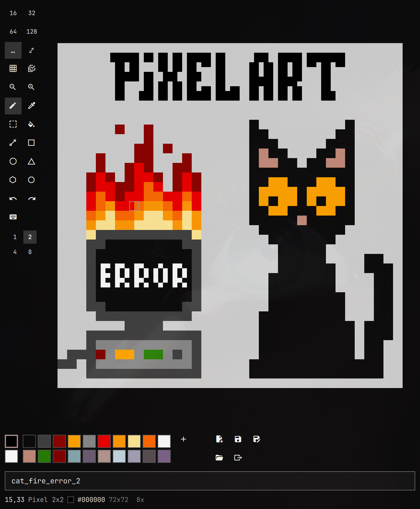

# PixelArt

<p align="center"></p>

A small, keyboard-driven pixel art editor for [Omarchy](https://omarchy.org).
It runs as an Omarchy shell plugin: a keybind opens it as a normal tiled
Hyprland window, and it restyles itself live whenever you change the Omarchy theme.

## Features

- Canvas from 16x16 up to 512x512, with zoom, grid, and resize that pads or crops
- Pen (1x1 to 8x8), eraser, eyedropper, color fill, and pixel-perfect shapes:
  line, rectangle, circle, triangle, hexagon, octagon
- Selection: move, copy, cut, paste, flip, rotate. Copy and paste use the system
  clipboard, so you can paste images to and from other apps
- 22-color palette. A new image starts with the theme's colors, and a loaded
  image brings its own. Color picker with HSV, RGB and HSL modes, plus a
  pipette that picks colors from anywhere on screen
- Undo and redo for every tool
- PNG save and load, and export upscaled 4x, 8x or 16x without blur
- Every action has a key, and you can rebind them in the app

No layers, animation, symmetry, anti-aliasing or filled shapes, by design.

## Install

Requires Omarchy 4, `wl-clipboard` (copy and paste) and `hyprpicker` (screen pipette).

```bash
omarchy plugin add https://github.com/Motzemoere/PixelArt.git --enable
```

Then bind a key to open and close it in `~/.config/hypr/bindings.lua`:

```lua
o.bind("SUPER + ALT + P", "PixelArt", "omarchy-shell shell toggle motzemoere.pixelart")
```

## Usage

Press the keybind and draw. The last image reopens automatically, and the
current one is saved when you close the window.

| Key | Action | Key | Action |
|---|---|---|---|
| arrows | move cursor | `space` | draw / set point |
| `p` | pen (again: bigger) | `c` | erase |
| `i` | eyedropper | `b` | color fill |
| `v` | select | `l` `r` `t` | line, rectangle, triangle |
| `1`-`0` | pick color | `a` | new color |
| `ctrl+z` / `ctrl+y` | undo / redo | `+` / `-` | zoom |
| `s` / `o` / `n` | save / load / new | `e` | export |
| `shift+k` | keybinding menu | `q` | quit |

The mouse works too: left click draws, right click erases. The full list of
keybindings is in [features.md](features.md#keybindings).

## Files

- Images: `~/Pictures/PixelArt/*.png`
- Exports: `~/Pictures/PixelArt/Export/`
- Editor state (last file, palette, size, keybindings): `~/.local/state/omarchy/pixelart.json`

## Development

Link the checkout as a plugin and run the logic tests:

```bash
ln -s "$PWD" ~/.config/omarchy/plugins/motzemoere.pixelart
omarchy plugin enable motzemoere.pixelart
node tests/logic.test.mjs
```

The shell caches compiled QML, so run `omarchy-restart-shell` to load edits.
The UI is QML; the drawing logic lives in plain JavaScript (`Pixels.js`,
`Png.js`) so it can be tested with `node`. [features.md](features.md) is the
feature spec, and design decisions are in [docs/adr/](docs/adr/).
